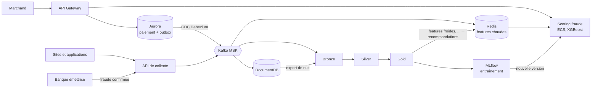

# Architecture de données et d'IA : étude de cas Stripe

Livrables du **Bloc 2 (RNCP41993BC02)** de la certification **RNCP41993 Architecte IA** :
*Concevoir et déployer l'infrastructure de données et de calcul pour l'IA*.

| | |
|---|---|
| **Auteur** | Ronan GUILLOU |
| **Version** | 1.1 |
| **Date** | 16/10/2026 |
| **Cas d'étude** | Stripe |

> Projet réalisé à des fins pédagogiques, à partir d'un business case fourni dans le cadre de la formation. Il n'est pas affilié à Stripe et n'utilise aucune donnée interne de l'entreprise.

## Contexte

Stripe est une plateforme de paiement en ligne qui traite des milliards de transactions par an pour des millions de marchands. Son métier repose sur trois exigences : la **confiance** (un paiement n'est jamais perdu ni traité deux fois), la **rapidité** (décision de fraude en moins de 100 ms) et la **sécurité** (RGPD, CCPA, PCI-DSS).

Le projet répond à ce contexte en réunissant **trois systèmes de données** sur une même plateforme, qui alimente aussi l'IA :

- **OLTP** : enregistrer les paiements de façon fiable (ACID, haute disponibilité) ;
- **OLAP** : analyser l'activité sur de gros volumes (revenus, segmentation, fraude) ;
- **NoSQL** : stocker les données de forme variable (logs, clics, sessions, avis) qui nourrissent les modèles.

## Architecture retenue

| Système | Technologie | Rôle |
|---|---|---|
| **OLTP** | PostgreSQL sur AWS Aurora Multi-AZ | Source de vérité des paiements, table outbox |
| **Capture et transport** | Debezium (CDC), Kafka (AWS MSK) | Publication des événements sans ralentir le paiement |
| **OLAP** | Lakehouse Databricks, Delta Lake sur S3 (Bronze, Silver, Gold) | Historique, BI, features froides, entraînement |
| **NoSQL** | AWS DocumentDB | Sessions, clics, logs, avis, signaux ML |
| **Cache temps réel** | Redis (AWS ElastiCache) | Compteurs de fraude lus en moins d'une milliseconde, recommandations de personnalisation (espace séparé) |
| **Scoring** | AWS ECS Fargate, XGBoost | Décision de fraude en moins de 100 ms |
| **Entraînement** | MLflow (Databricks) | Registre, versions, réentraînement hebdomadaire sur les fraudes confirmées par la banque |
| **Personnalisation et prévisions** | Lots Databricks sur Gold | Filtrage collaboratif (résultats servis via Redis), séries temporelles (résultats rendus à la BI) |
| **Boucle de feedback** | API de collecte, Kafka (topic `fraud_labels`), Bronze | Vraies valeurs de fraude renvoyées par la banque émettrice, cible d'apprentissage du modèle |
| **Orchestration** | Databricks Workflows | Traitements par lots, relances, dépendances |
| **Infrastructure as Code** | Terraform | Réseau, bases, calcul, droits et espace Databricks décrits en code, mêmes environnements de test et de production |
| **Entrée et supervision** | AWS WAF, API Gateway, CloudWatch | Filtrage, points d'entrée (paiement et collecte), alertes |
| **Sécurité et gouvernance** | AWS KMS, IAM, Secrets Manager, Unity Catalog, CloudTrail | Chiffrement, accès, secrets, catalogue, audit |



## Contenu du dépôt

```
.
├── README.md
└── docs/
    ├── D2_L0_Fiche_specifications.docx
    ├── D2_L1_ERD_OLTP.docx
    ├── D2_L2_ERD_OLAP.docx
    ├── D2_L3_Schema_NoSQL.docx
    ├── D2_L4_Pipeline_donnees.docx
    ├── D2_L5_Strategie_ML.docx
    ├── D2_L6_Securite_conformite.docx
    ├── D2_L7_Diagramme_architecture.docx
    ├── D2_L8_Requetes_SQL_NoSQL.docx
    └── D2_L9_Soutenance_bloc2_v2.pdf
```

| Livrable | Document | Contenu |
|---|---|---|
| **Cadrage** | [Fiche de spécifications fonctionnelles](docs/D2_L0_Fiche_specifications.docx) | Contexte, enjeux, acteurs, fonctionnalités attendues par domaine, liste des 8 livrables. |
| **L1** | [ERD du système OLTP](docs/D2_L1_ERD_OLTP.docx) | Schéma normalisé en 4 schémas (reference, actor, payment, audit), justification de chaque table. |
| **L2** | [ERD du système OLAP](docs/D2_L2_ERD_OLAP.docx) | Schéma en étoile : 3 tables de faits (dont les étiquettes de fraude), 6 dimensions, règles de signe et de dénormalisation. |
| **L3** | [Schéma NoSQL](docs/D2_L3_Schema_NoSQL.docx) | 6 collections de documents, stratégies de relation, 8 compteurs Redis et liste de blocage, espace séparé pour les recommandations. |
| **L4** | [Architecture du pipeline](docs/D2_L4_Pipeline_donnees.docx) | Flux critique et secondaire, outbox, CDC, médaillon, boucle de feedback (étiquettes de fraude), orchestration, monitoring et reprise. |
| **L5** | [Stratégie d'intégration du ML](docs/D2_L5_Strategie_ML.docx) | Variables chaudes et froides, 3 cas d'usage, boucle de feedback, déploiement, suivi, conformité des modèles. |
| **L6** | [Sécurité et conformité](docs/D2_L6_Securite_conformite.docx) | Cadre réglementaire, chiffrement, clés et secrets, tokenisation, RBAC, audit, incidents (v2.0). |
| **L7** | [Diagramme d'architecture complet](docs/D2_L7_Diagramme_architecture.docx) | Vue d'ensemble des 3 systèmes (banque émettrice comprise), tableau des 20 composants, vue simplifiée par zones, industrialisation par Terraform. |
| **L8** | [Requêtes SQL et NoSQL](docs/D2_L8_Requetes_SQL_NoSQL.docx) | 6 requêtes OLTP, 5 requêtes OLAP, 2 pipelines d'agrégation MongoDB/DocumentDB. |
| **L9** | [Support de soutenance](docs/D2_L9_Soutenance_bloc2_v2.pdf) | 12 diapositives : besoin, architecture, vitesse, résilience, sécurité, IA, synthèse, et 3 annexes (choix techniques, architecture complète, flux). |

Ordre de lecture conseillé : la fiche de spécifications, L7 (vue d'ensemble), puis L1 à L6, et L8 en dernier. La soutenance (L9) résume l'ensemble en 12 diapositives.

## Résumé des livrables

### L1 à L3 : les trois systèmes de données

- **OLTP.** La table `transaction` est en insertion seule et partitionnée par mois : un remboursement est une nouvelle ligne. `idempotency_key` empêche un double paiement, `fraud_assessment` rend chaque décision auditable, `audit_log` n'enregistre que les noms de colonnes modifiées.
- **PCI-DSS dès la conception.** Aucun numéro de carte n'est stocké : seulement un jeton, la marque, les 4 derniers chiffres et une empreinte (fingerprint).
- **OLAP.** `fact_transaction` (une ligne par paiement ou remboursement), `fact_payment_item` (une ligne par produit) et `fact_fraud_label` (la vraie valeur de fraude renvoyée par la banque, table séparée pour garder les faits en insertion seule). Le net se calcule par un simple `SUM(signed_amount_eur)`.
- **NoSQL.** Six collections (sessions, click_events, logs, customer_feedback, ml_features, inbound_payloads) avec une stratégie embedding ou référence justifiée et un TTL de 90 jours. Huit compteurs Redis (C1 à C8) alimentent la détection de fraude.

### L4 : pipeline de données

- **Flux critique.** Le paiement, son évaluation de fraude et l'événement outbox sont écrits dans **une seule transaction**. Debezium publie ensuite dans Kafka : si Kafka tombe, les paiements continuent.
- **Flux secondaire.** Logs, clics, sessions et avis passent par l'API de collecte, Kafka, DocumentDB, puis un export de nuit vers Bronze.
- **Boucle de feedback.** Les fraudes confirmées par la banque émettrice arrivent par l'API de collecte, dans un topic Kafka dédié (`fraud_labels`) lu directement par Bronze, sans passer par DocumentDB ni par Aurora. Elles sont jointes aux transactions dans Gold et servent de cible d'apprentissage au réentraînement.
- **Fiabilité.** Livraison « au moins une fois » compensée par des consommateurs **idempotents** (`MERGE`), quarantaine et DLQ, Bronze comme source de rejeu, `RESTORE` Delta.
- **Fraîcheur.** Chaque flux reçoit la fraîcheur que son usage exige : instantanée, quelques secondes, quelques minutes, journalière.

### L5 : intégration du machine learning

- Trois cas d'usage sur une même plateforme : **fraude** (XGBoost, ECS Fargate, moins de 100 ms), **personnalisation** (filtrage collaboratif calculé chaque jour par lots Databricks, résultats servis via Redis, produits populaires en repli pour les nouveaux clients) et **prévisions** (séries temporelles, résultats rendus à la BI).
- Le modèle de fraude apprend des **vrais résultats renvoyés par la banque**, et non de ses propres décisions.
- Cycle de vie : entraînement sur Gold, version « challenger » dans MLflow, validation par le Model Owner, mise en service, retour arrière possible, réentraînement hebdomadaire.
- Suivi : faux refus calculés en comparant chaque décision au vrai résultat de la banque, dérive des variables, temps de réponse, alertes CloudWatch.
- Chaque décision de fraude garde son score, ses motifs et la version du modèle.

### L6 : sécurité et conformité

- Matrice RGPD, CCPA et PCI-DSS traduite en mesures et en preuves.
- Chiffrement KMS avec une clé par domaine, TLS partout, secrets dans Secrets Manager, jamais dans le code ni dans les fichiers Terraform.
- RBAC par rôle (IAM et Unity Catalog), réseau segmenté en zones publique et privée, journaux CloudTrail dans un compte AWS séparé.
- Droit à l'effacement : la personne est anonymisée dans toutes les couches, les paiements (et les retours de la banque qui leur sont rattachés) sont conservés comme la loi l'impose, délai effectif inférieur à un mois. Rapports de conformité quotidiens, procédure de notification sous 72 h.

### L7 et L8 : vue d'ensemble et requêtes

- Un diagramme complet (flux, technologies, légende des fraîcheurs) et un tableau de 20 composants, avec la sortie de chacun.
- **Industrialisation.** L'infrastructure est décrite en code avec Terraform : un seul code crée les environnements de test et de production, les modifications sont relues avant application, les secrets n'y figurent jamais, et l'infrastructure se recrée à partir du code en cas de sinistre. Il s'agit d'une stratégie décrite : le dépôt ne contient pas de fichiers Terraform.
- Des requêtes qui répondent à des questions métier : paiements bloqués, test de cartes, demandes d'effacement en retard, CA net par mois et pays, top marchands, segmentation par quartiles, sessions ressemblant à un bot, erreurs derrière les avis négatifs.

### L9 : soutenance

- Un fil conducteur : payer en 100 ms, sans jamais perdre un paiement, tout en évitant la fraude.
- Deux flux d'entrée vers le lakehouse (critique et secondaire), trois cas d'usage IA sur une même plateforme, et une synthèse qui relie chaque attente du business case à sa réponse.
- Trois annexes : les choix techniques et leur justification (industrialisation par Terraform comprise), l'architecture complète, et le tableau des flux avec leur fraîcheur.

## Correspondance avec les compétences du Bloc 2

| Compétence | Où la trouver |
|---|---|
| Concevoir une architecture Data & IA logique et physique, évolutive et industrialisable | L7, L4, L5, L9 |
| Structurer les environnements (Data Lake, conteneurs, cache) | L4, L5, L7 |
| Garantir la résilience et la haute disponibilité (failover, reprise) | L1, L4 (§5), L7 |
| Mettre en place la sécurité (IAM, chiffrement, gestion des secrets) | L6 |
| Industrialiser via Infrastructure as Code (Terraform) | L7, L9 (annexe 1) |
| Documenter et coordonner les équipes techniques | Fiche de spécifications, rôles de gouvernance dans L5 et L6, soutenance L9 |
| Spécifications techniques (CPU/GPU, stockage, réseau) | Oral |
| Arbitrage Cloud / On-premise / Hybride, IaaS / PaaS / Serverless | Oral |
| Pilotage de l'efficience (FinOps / GreenOps) | Oral |

## Sources et références

- Business case Stripe (cas d'étude de la formation)
- Énoncé du projet « Design Stripe AI Infrastructure »
- Notebook de pratique Delta Lake et architecture médaillon (Databricks)

## Note sur l'usage de l'IA

Un assistant d'IA générative a servi d'aide à la rédaction (orthographe, propositions de structure relues et modifiées, comparaison d'options, cohérence d'ensemble). Les choix, la sélection des besoins et la validation de chaque livrable relèvent de ma responsabilité.

## Statut

Livrables en version 1.1 (le livrable 6 est en version 2.0), remis pour l'évaluation du Bloc 2.